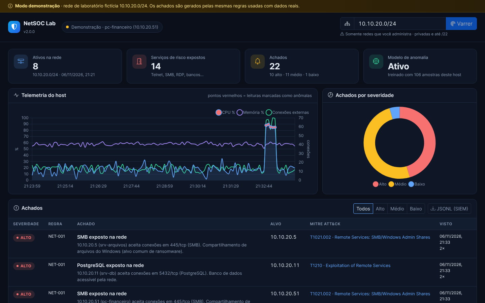
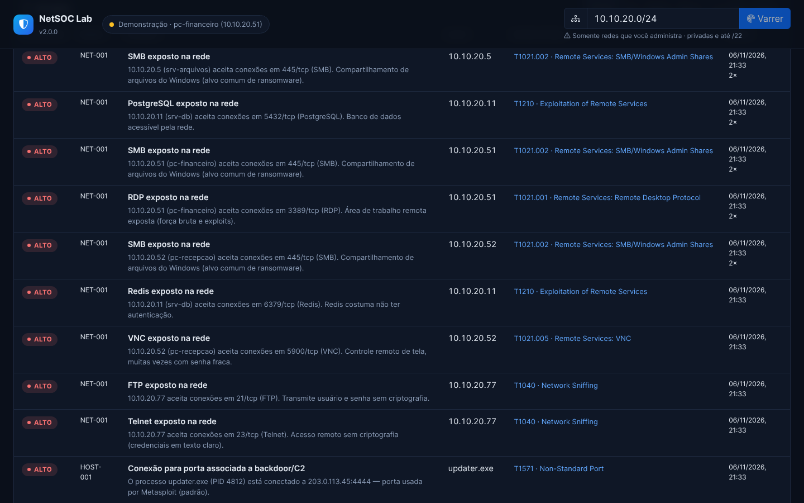
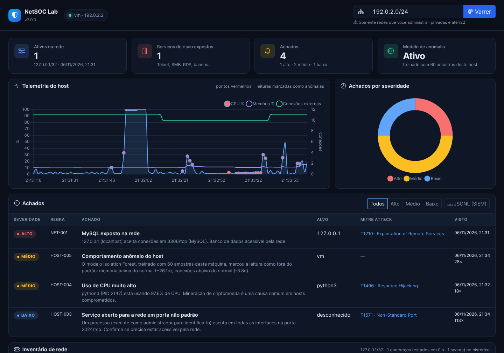
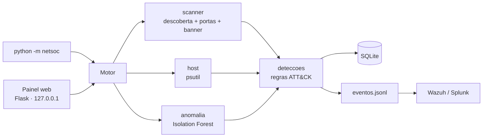

# NetSOC Lab

[](https://github.com/Cipriano2004/security-network-portfolio/actions/workflows/ci.yml)


Ferramenta de laboratório para **SOC/NOC**: faz o inventário de uma rede local, aponta serviços de risco expostos, percebe mudanças entre varreduras, monitora o próprio computador e gera alertas mapeados no **MITRE ATT&CK**. Os alertas também saem em **JSON Lines**, prontos para entrar num SIEM como Wazuh ou Splunk.



> **Dados reais ou de demonstração?** Com `serve`, o painel mostra a telemetria **real** do computador onde roda e o resultado **real** das varreduras que você fizer. Com `serve --demo`, carrega uma rede de laboratório **fictícia**, marcada com uma faixa amarela no topo. Nos dois modos, os alertas saem das mesmas regras.

## O que ele faz

| Área | Como funciona |
|---|---|
| **Descoberta de hosts** | Sondagem TCP em portas comuns: um host é considerado ativo se aceita **ou recusa** a conexão (RST). Funciona mesmo com ping bloqueado e sem privilégios de administrador. |
| **Varredura de portas** | *TCP connect scan* nas 30 portas do catálogo, com captura de banner (SSH, FTP, SMTP e cabeçalho `Server:` HTTP) e palpite do tipo de dispositivo. |
| **Inventário com histórico** | Cada scan fica salvo em SQLite; o próximo scan do mesmo alvo é comparado com o anterior. |
| **Detecções** | 9 regras (abaixo), cada uma ligada a uma técnica do ATT&CK, com severidade, evidência e deduplicação. |
| **Monitoramento do host** | CPU, memória, conexões, processos e portas em escuta via `psutil`, a cada 5 s. |
| **Anomalia com ML** | *Isolation Forest* treinado com as amostras **desta máquina** (linha de base). Explica o alerta pelos desvios (σ) de cada métrica. |
| **Integração com SIEM** | Alertas novos gravados em `dados/eventos.jsonl` (campos inspirados no Elastic Common Schema) e exportáveis pelo painel. |

### Regras de detecção

| Regra | Detecta | Severidade | MITRE ATT&CK |
|---|---|---|---|
| NET-001 | Serviço de risco exposto: Telnet, FTP, SMB, RDP, VNC, bancos de dados, Redis, Docker API, RTSP… | médio / alto | T1021.x, T1040, T1210, T1078.001 |
| NET-002 | Dispositivo novo na rede (não estava no scan anterior) | médio | T1200 Hardware Additions |
| NET-003 | Porta nova aberta em dispositivo conhecido | médio | T1571 Non-Standard Port |
| NET-004 | Dispositivo deixou de responder | baixo | — |
| HOST-001 | Conexão de saída para porta associada a backdoor/C2 (4444, 1337, 31337…) | alto | T1571 Non-Standard Port |
| HOST-002 | Processo conversando com muitos IPs externos distintos | médio | T1041 Exfiltration Over C2 Channel |
| HOST-003 | Serviço escutando em todas as interfaces numa porta não padrão | baixo | T1571 Non-Standard Port |
| HOST-004 | Processo com uso de CPU sustentado acima de 90% | médio | T1496 Resource Hijacking |
| HOST-005 | Leitura do host fora do padrão aprendido (Isolation Forest) | médio | — |



### Testado com dados reais

Rodando em modo real, provoquei um pico de CPU de 10 segundos na máquina. O sistema gerou dois alertas sozinho:

- **HOST-004**, apontando o processo e o PID responsáveis.
- **HOST-005**, do modelo de anomalia, explicando o motivo: *"CPU acima do normal (+61σ)"*.

A varredura de `127.0.0.1` encontrou o MySQL que estava rodando na máquina e gerou o NET-001.



## Uso responsável

Varrer redes sem autorização pode configurar crime no Brasil (**Lei 12.737/2012**, art. 154-A do Código Penal) e viola termos de uso de provedores. Por isso:

- o NetSOC **recusa alvos públicos** e aceita só redes privadas (RFC 1918), loopback e link-local, até **/22** (1.024 endereços);
- um alvo público autorizado por escrito exige a opção explícita `--autorizado` na linha de comando e **não pode ser escaneado pelo painel web**;
- o servidor web escuta **somente em 127.0.0.1**.

Use em casa, no seu homelab ou em redes em que você tenha permissão por escrito.

## Como rodar

Requer Python 3.11+.

```bash
git clone https://github.com/Cipriano2004/security-network-portfolio.git
cd security-network-portfolio
python -m venv .venv
.venv\Scripts\activate            # Linux/macOS: source .venv/bin/activate
pip install -r requirements.txt
```

```bash
python -m netsoc serve --demo              # painel com a rede fictícia → http://127.0.0.1:8080
python -m netsoc serve                     # painel monitorando ESTE computador
python -m netsoc scan 192.168.0.0/24       # varredura pelo terminal (mostra os achados)
python -m netsoc scan 192.168.0.0/24 --json
python -m netsoc host                      # avalia só o computador local
```

No modo real, o modelo de anomalia precisa de cerca de 2,5 minutos (30 leituras) para aprender a linha de base. Para ver o nome do processo dono de cada porta em escuta, execute o terminal como administrador.

### Enviando os alertas para o Wazuh

No agente do Wazuh (`ossec.conf`), aponte para o arquivo de eventos:

```xml
<localfile>
  <log_format>json</log_format>
  <location>C:\caminho\security-network-portfolio\dados\eventos.jsonl</location>
</localfile>
```

Cada linha chega com `rule.id`, `event.severity` e `threat.technique.id`, prontos para regras e dashboards no SIEM.

## Arquitetura



```
netsoc/
├── alvos.py          # validação e travas do alvo (só redes privadas, até /22)
├── scanner.py        # descoberta TCP, varredura de portas e banners
├── servicos.py       # catálogo de portas: risco, motivo e técnica ATT&CK
├── host.py           # telemetria do computador (psutil)
├── deteccoes.py      # 9 regras de detecção
├── anomalia.py       # Isolation Forest + explicação por desvio padrão
├── armazenamento.py  # SQLite + log JSON Lines
├── motor.py          # coleta contínua, scans em segundo plano, retreino do modelo
├── demo.py           # rede de laboratório fictícia (modo demonstração)
├── __main__.py       # linha de comando
└── web/              # API JSON e painel (Bootstrap e Chart.js servidos localmente)
```

**Segurança do próprio painel:** a API só aceita `POST` da mesma origem e com um cabeçalho próprio (proteção contra CSRF vinda de outros sites), envia **CSP** sem script inline nem CDN e insere todo texto vindo da API com `textContent` (sem `innerHTML`), evitando XSS a partir de banners ou hostnames maliciosos na rede.

## Testes

```bash
pip install -r requirements-dev.txt
pytest --cov=netsoc
ruff check .
```

São 41 testes, incluindo:

- varredura **real** contra um servidor TCP falso aberto em localhost, com leitura de banner SSH;
- travas de alvo;
- cada regra de detecção;
- o modelo de anomalia separando leitura normal de pico;
- deduplicação e formato do JSONL;
- proteções da API.

O [CI](.github/workflows/ci.yml) roda lint e testes em Python 3.11 e 3.12 no Linux e no Windows.

## Limitações conhecidas

- **Portas:** só TCP. Não faz varredura UDP, que exige privilégios elevados.
- **Tipo de dispositivo:** é um palpite pelas portas abertas, não *fingerprinting* de sistema operacional.
- **Anomalia:** o modelo aprende o "normal" da própria máquina. Se ela já estiver comprometida durante o aprendizado, esse comportamento vira linha de base.
- **HOST-002:** navegadores falam legitimamente com muitos destinos. A regra existe para chamar atenção a outros processos, e o limiar é ajustável em `deteccoes.py`.

## Autor

**Ariel Cipriano do Nascimento** · [LinkedIn](https://www.linkedin.com/in/ariel-cipriano)

Outro projeto: [Gestão de Ofícios](https://github.com/Cipriano2004/gestao-oficios), um sistema web com trilha de auditoria e controles OWASP.
